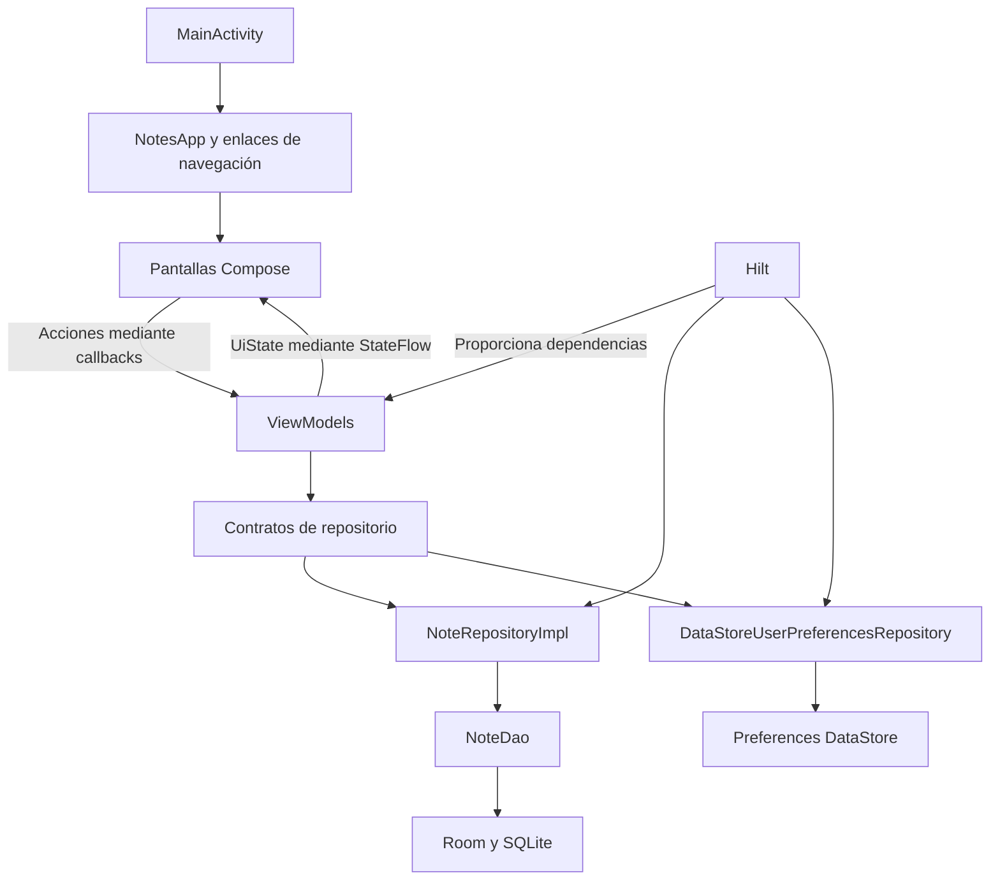
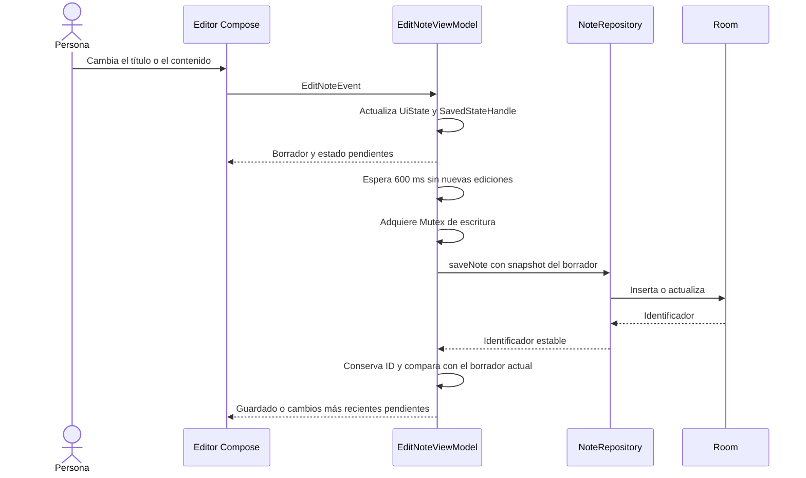

# Arquitectura

## Decisión

Clean Mind utiliza **MVVM con flujo unidireccional de datos (UDF), dos capas y un único módulo Gradle**. La decisión se tomó para el alcance actual: notas locales, carpetas, recordatorios, búsqueda y una preferencia de apariencia.

La capa de presentación recibe datos mediante repositorios y expone estado a Compose. La capa de datos encapsula Room y DataStore. Los modelos compartidos no dependen de Android.

| Alternativa | Evaluación para esta app |
| --- | --- |
| Clean Architecture con casos de uso obligatorios | Los envoltorios de lectura y borrado anteriores no contenían reglas que justificaran una clase por llamada. Una capa de dominio puede incorporarse si aparecen flujos complejos. |
| MVI con infraestructura de reducers y efectos | La disciplina de estado y acciones es útil, pero la app no necesita un framework adicional para aplicarla. |
| MVVM + UDF con dos capas | Elegida por su separación de responsabilidades, capacidad de prueba y menor coste de mantenimiento en este proyecto. |

Esta elección no obliga a mantener siempre dos capas: cambiará si cambian las necesidades de la app.

## Flujo de dependencias y datos



Los contratos permiten sustituir almacenamiento por dobles de prueba. Hilt construye los objetos; no sustituye el contrato ni introduce acceso directo a la base de datos desde la UI.

## Estructura del código

El paquete base es `com.example.cleannotes` dentro de `app/src/main/java/`.

```text
com/example/cleannotes/
├── MainActivity.kt
├── NotesApplication.kt
├── model/
│   ├── Note.kt
│   └── ThemeMode.kt
├── data/
│   ├── repository/     # Contrato y repositorio de notas
│   ├── source/         # DAO, entidad, base de datos y migración
│   └── preferences/    # Contrato y repositorio de preferencias
├── di/                 # StorageModule y RepositoryModule
└── presentation/
    ├── navigation/     # Destinos y conexión de pantallas con ViewModels
    ├── notebook/       # Estado y lógica del cuaderno y sus pestañas
    ├── ui/
    │   ├── home/
    │   ├── search/
    │   ├── edit_note/
    │   ├── settings/
    │   ├── components/
    │   └── theme/
    └── util/           # Formato y agrupación de fechas
```

## Responsabilidades

| Componente | Responsabilidad |
| --- | --- |
| `MainActivity` | Instalar la splash nativa, activar edge-to-edge e instalar `NotesApp`. |
| `NotesApplication` | Punto de entrada de Hilt. |
| `NotesApp` | Aplicar el tema, gestionar el back stack, obtener ViewModels y conectar estado y callbacks. |
| `NotesViewModel` | Observar notas/carpetas, derivar colecciones y búsqueda, conservar consulta/pestaña/carpeta y gestionar mutaciones y errores. |
| `EditNoteViewModel` | Cargar una nota, mantener el borrador, coordinar autoguardado y solicitar la salida mediante estado. |
| `SettingsViewModel` | Observar la apariencia y gestionar fallos de lectura o escritura. |
| Pantallas Compose | Representar estado, controlar interacciones visuales locales y emitir callbacks. |
| `NoteRepository` | Contrato para observar, consultar, guardar y eliminar notas. |
| `NoteRepositoryImpl` | Validar el título y traducir entre modelos y entidades usando el DAO. |
| `UserPreferencesRepository` | Contrato de observación y cambio del tema. |
| `NoteDao` | Consultas y escrituras SQLite mediante Room. |
| Módulos Hilt | Mantener las instancias compartidas y enlazar contratos con implementaciones. |

Las pantallas no reciben repositorios ni controladores de navegación. Las llamadas a `hiltViewModel()` y la recopilación de estado se concentran en los enlaces de `NotesApp`.

## Estado y ciclo de vida

Los ViewModels exponen valores inmutables a través de `StateFlow`:

| Estado | Datos principales |
| --- | --- |
| `NotesUiState` | Colección completa, notas, recordatorios, resultados, consulta, pestaña, carga y error. |
| `EditNoteUiState` | Título, contenido, tipo, guardado, carga, cierre, cambios y solicitud de salida. |
| `SettingsUiState` | Tema, carga y presencia de error. |

Los flujos derivados del repositorio usan `stateIn` con `SharingStarted.WhileSubscribed(5_000)`. La observación se mantiene durante un breve periodo al desaparecer sus suscriptores y después se detiene. Los enlaces recopilan con `collectAsStateWithLifecycle`.

El editor mantiene un `MutableStateFlow` privado porque su estado es principalmente un borrador editable, no una transformación continua de un flujo de la base de datos.

`SavedStateHandle` conserva consulta, pestaña e información del borrador. `rememberSaveableStateHolder` separa el estado visual de las pestañas. Los menús y diálogos usan estado local de Compose. Ninguno de estos mecanismos sustituye la persistencia de una nota en Room.

## Navegación

[Destination.kt](../app/src/main/java/com/example/cleannotes/presentation/navigation/Destination.kt) define tres destinos serializables:

| Destino | Argumentos |
| --- | --- |
| `Notebook` | Ninguno. |
| `Settings` | Ninguno. |
| `Editor` | `noteId: Int?` e `isReminder: Boolean`. |

Las cuatro pestañas son vistas del mismo cuaderno, no cuatro back stacks independientes. Comparten el ViewModel del destino `Notebook` y conservan por separado su estado visual. Volver desde una pestaña secundaria lleva a Inicio.

Navigation 3 utiliza `rememberNavBackStack`, un decorador para estado guardable y otro para el ámbito de ViewModel por entrada. El editor recibe sus argumentos mediante la factoría asistida de Hilt. La nota completa no se pasa por navegación.

El tema se observa desde un ViewModel de ajustes obtenido en la raíz de la composición de la app. La selección afecta también a las pantallas que no son Ajustes.

## Edición y autoguardado



Una nueva pulsación puede cancelar la espera, pero no cancela la escritura ya iniciada. El `Mutex` evita escrituras simultáneas y el ID devuelto permite actualizar la misma fila en los siguientes guardados.

Al guardar y cerrar, el ViewModel bloquea nuevas ediciones, espera la escritura necesaria y publica `exitRequested`. La UI observa esa propiedad y realiza la navegación. El ViewModel no conserva callbacks de la pantalla.

Los errores de almacenamiento se representan en el estado. Las cancelaciones de corrutinas se propagan. No hay un canal de eventos de navegación separado que deba consumirse una sola vez.

## Escalabilidad

Mantén la estructura actual mientras las reglas sigan siendo pequeñas. Valora extraer casos de uso cuando una operación combine reglas reutilizadas por varios ViewModels, por ejemplo sincronización con resolución de conflictos o exportación con transformación de datos.

Valora módulos adicionales cuando haya responsabilidades de equipo, tiempos de compilación o funcionalidades independientes que los justifiquen. Para colecciones muy grandes, mide primero el coste de derivar búsqueda y filtros en memoria; después considera consultas específicas, índices o paginación.

## Referencias de la decisión

La revisión arquitectónica del 23 de noviembre de 2026 utilizó estas fuentes oficiales:

- [Recomendaciones de arquitectura Android](https://developer.android.com/topic/architecture/recommendations).
- [Navigation 3](https://developer.android.com/guide/navigation/navigation-3).
- [Conservación del estado de navegación](https://developer.android.com/guide/navigation/navigation-3/save-state).
- [DataStore](https://developer.android.com/topic/libraries/architecture/datastore).
- [Migraciones Room](https://developer.android.com/training/data-storage/room/migrating-db-versions).

[Índice de documentación](README.md).

## Editor enriquecido

El cuerpo del editor integra `RichNoteEditor`, un EditText nativo dentro de Compose para mantener selección y menú de copiar/pegar. `NoteDocument` es el formato serializable sin dependencia de Android; los spans nativos se convierten a rangos al editar. `RichEditorContent` integra el campo nativo; `RichEditorController` conserva exclusivamente estado de UI (selección, historial disponible y resultados de galería/cámara). `EditorToolbar` presenta la barra inferior y las hojas de inserción y espaciado; `NoteImageStrip` presenta los adjuntos. El documento sigue siendo propiedad del ViewModel y todas las modificaciones viajan por `EnteredContent`. `NoteImages` encapsula la copia y normalización de los archivos en el almacenamiento privado. La nota resultante continúa pasando por el evento de contenido y el autoguardado del ViewModel.


## Avisos y exportaciones

`NoteDocument.reminder` contiene la configuración opcional. `NoteRepositoryImpl` confirma la escritura Room, actualiza `ReminderScheduler` y, si hay carpeta elegida, intenta actualizar la copia TXT. Los fallos de la copia externa no invalidan el original Room: se conservan como aviso en Ajustes. `ReminderScheduler` usa AlarmManager, PendingIntent inmutable por ID y canales por combinación de sonido/vibración/prioridad. Conserva un índice en preferencias para reprogramar tras boot, cambio de hora y actualización. `ReminderReceiver` publica la notificación, pospone y programa la siguiente ocurrencia. La notificación abre `Destination.Editor` mediante el ID.

`NoteExport` encapsula TXT UTF-8, PDF A4 con saltos de página e imágenes, archivos compartidos en caché y escritura mediante DocumentsContract. El permiso persistente SAF limita el acceso a la carpeta elegida; no se solicitan permisos generales de almacenamiento. `ExportMenu` realiza IO en background. Room sigue siendo la fuente de verdad; las copias TXT no restauran formatos ni adjuntos.

La agenda de Inicio se presenta con `AgendaDayGroup`, agrupando por `Note.creationTimestamp()`. El repositorio conserva la creación dentro del documento independientemente del timestamp de edición. `CustomTopBar` y `BottomNavigationBar` vuelven a ser las barras activas de la libreta. Ajustes expone de nuevo apariencia y almacenamiento directamente.

## Recordatorios como tareas

`NotesApp` muestra `ReminderEditorScreen` cuando el documento es un recordatorio independiente. Comparte el ViewModel y el repositorio con las notas para conservar compatibilidad de datos; la presentación y el guardado son distintos. `EditNoteViewModel` mantiene el borrador pero no inicia autoguardado para `isReminder`: solo `saveAndClose` persiste la tarea. Las notas normales conservan el debounce de 600 ms. Los recordatorios vinculados a notas mantienen su hoja de configuración y no cambian el tipo de la nota.

Las carpetas usan la misma capa de datos, con `FolderEntity` y una clave externa de nota. Su operación expone carga, error y revisión de persistencia; las hojas solo confirman al completarse la escritura. `AppMotion` centraliza las transiciones y el contenedor guardable de pestañas conserva el scroll durante el cambio de vista. Consulta [Carpetas](carpetas.md) y [Movimiento](movimiento.md).

`AppSurfaces.kt` centraliza las superficies tonales Material 3 y las hojas inferiores. El fondo se dibuja uniformemente desde el tema; ya no se captura ni se desenfoca mediante Haze. Las carpetas y las notas comparten una cuadrícula perezosa con spans distintos, y lista/cuadrícula usan contenedores separados durante el fundido. La colección científica se inicializa desde una implementación exclusiva de debug; el código release no añade ejemplos.
